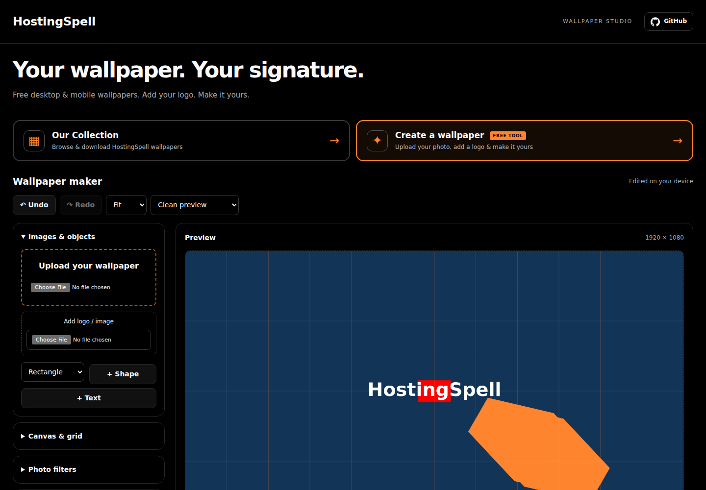
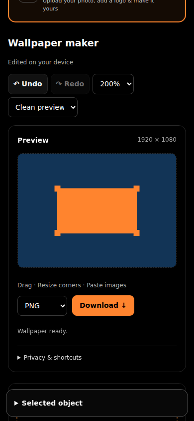

# HostingSpell Wallpaper Studio

A free wallpaper gallery and browser-based wallpaper workbench. Version **2.0.0**, MIT licensed source.

[Live demo](https://manage.hostingspell.com/tools/walls/index.php) · [Source](https://github.com/thekugelblitz/hostingspell-wallpaper-studio)

## Features

- Local image editing: new uploads, text, shapes, logos, filters and finished images stay in the browser. No image upload API is used by the new editor.
- Multiple image, text and shape layers, with lock/hide, duplicate, delete, forward/backward order, rotation, opacity and numeric dimensions. Maximum 40 layers.
- Rectangle, square, rounded rectangle, circle, ellipse, triangle, diamond, pentagon, hexagon, polygon, star, arrow and line. Solid/hollow styles, colours, stroke, corner radius, polygon sides and star parameters.
- Dragging, four corner resize handles, keyboard nudging, clipboard images, drop onto canvas, pinch zoom and desktop/phone preview overlays.
- Undo/redo (40 document states), smart alignment to canvas and object edges, independent grid visibility/snapping, pixel or nested row/column grids, and quick alignment.
- Grayscale, vintage, warm, cool, noir and fade filters; strength, brightness, contrast and saturation. Filters affect the wallpaper; logo colours remain intact.
- Text with six device font families, size, colour, weight, alignment, outline and shadow. Logos can use a shadow, white outline and dark backing plate.
- PNG, JPG and WebP export. Selection handles, grid, guides and device preview overlays never export.
- Portable `.hswall` projects with embedded images. Save up to eight independently positioned canvas layouts in a project and export them in one ZIP. Without saved layouts, ZIP exports desktop and phone versions.
- Optional device-local draft recovery and a reusable logo kit with brand colour and saved placements. Clear saved device data at any time. Draft recovery is off by default and browser storage can be cleared or evicted; project files are the portable backup.
- Gallery search, default natural name A–Z sorting, seven alternative sort orders, original downloads, shareable wallpaper URLs, “Use in editor,” and cached JPEG thumbnails. Collection favourites and category/colour filters are deliberately absent.
- Canonical/social metadata, individual wallpaper metadata, four useful guide pages, favicon, static sitemap and a dynamic sitemap including collection files.

## Install on PHP hosting

1. Upload **index.php** to `/public_html/tools/walls/index.php`.
2. Put public collection images in `/public_html/tools/walls/walls/` (a child directory beside index.php).
3. PHP 8.2+, Fileinfo and GD with PNG/JPEG/WebP support are required for legacy recovery, upload APIs and thumbnail generation. Use a 256 MB PHP memory limit. The host must permit private storage creation.
4. `process/` is generated automatically. Prefer a private absolute path outside the web root using `WPS_STORAGE`. The app protects default storage with `.htaccess`, guarded PHP files and restrictive permissions. For Nginx, explicitly deny the deployed `/tools/walls/process/` location.
5. Preserve the cleanup cron for old private workspaces and obsolete thumbnail cache entries:

```cron
*/5 * * * * /opt/cpanel/ea-php83/root/usr/bin/php /home/CPANEL_USER/public_html/tools/walls/index.php --cleanup >> /home/CPANEL_USER/wallpaper-cleanup.log 2>&1
```

6. Upload `sitemap.xml` and `llms.txt` if useful. Submit `https://manage.hostingspell.com/tools/walls/index.php?action=sitemap` to search engines to include current collection items.
7. Bypass CDN/LiteSpeed caching for application HTML and legacy private API routes. Cache public collection files and thumbnails. Keep `data-cfasync="false"` on the application script.

No production Node runtime, database or Astro build is needed. `editor-source.js`, `build.py`, tests and npm files are development files; `index.php` contains the complete editor.

## Upgrade from 1.x

Replace `index.php` and `sitemap.xml`, then purge cached HTML and app JavaScript. Preserve `walls/`, `process/`, storage environment settings and the cleanup cron. New images are edited locally. To recover an existing unexpired 1.x workspace, open **Projects & brand kit → Open previous server workspace**, then download a project file. The previous server workspace can also be deleted immediately using the separate deletion control. Legacy workspaces retain their original 24-hour expiry and isolation; they do not become public gallery images.

## Configure your own installation

Edit `SITE_URL`, `REPOSITORY_URL` and `BRAND_LOGO` near the top of `index.php`, the header/footer branding, and the URLs in sitemap.xml and llms.txt. Use a local brand image or update CSP if choosing a different remote image host. Keep canonical URLs on your main destination, not a URL shortener.

The gallery scans only the child `walls/` directory. Supported public image formats are JPEG, PNG, WebP, AVIF and GIF, subject to host decoding support for thumbnails. Thumbnail generation falls back to original files for unsupported formats or very large images. Original downloads are byte-for-byte unchanged. Default sorting is natural filename order; date sorting uses file modification time, and resolution uses pixel count.

## Browser privacy and limits

New PNG/JPG/WebP files are limited to 32 MB, 64 MP and 16,000 px per side before normalization. Backgrounds above 24 MP and image layers above 4 MP are resized with a visible message. An editing session is capped at 64 MP of decoded source images, including undo history. Reload after downloading a project to release the session image pool. Canvas export is capped at 16 MP, with dimensions from 320–7680 px per side. Large exports and ZIPs can still be constrained by a device's available memory.

Device drafts and brand kits use IndexedDB only when requested. They remain until cleared or removed by the browser. Saving a portable project embeds its images; share it only when you intend to share those assets. Optional old server workspace recovery uses the existing signed HttpOnly/SameSite cookie and CSRF-protected endpoints. The HTML retains that compatibility cookie. There are no accounts or analytics.

Canvas filters, clipboard paste/share, IndexedDB and touch gestures depend on browser capabilities. Use a current browser. WebP encoding can fall back to PNG; the downloaded extension follows the actual image MIME type. File download and project export remain the reliable backup when device storage is unavailable. Preview clocks and icons are illustrative, not exact OS safe areas.

The MIT licence applies to code. HostingSpell branding and gallery images require separate permission; bring your own assets when reusing the tool.

## Development

```sh
npm ci
python3 build.py
npm test
npm run test:browser
npm run test:sorting
npm run test:recovery
python3 tests/security_smoke.py http://127.0.0.1:8765/index.php
```

The HTTP security suite requires a fresh disposable local server and isolated writable WPS_STORAGE. The browser, sorting and recovery suites create disposable copies themselves. Install Playwright-compatible Chromium. `PHP_BIN`, `PHP_EXTRA_ARGS` (JSON array), `PHP_LIBRARY_PATH` and `CHROMIUM_PATH` select alternate runtimes. Never run mutation tests against production.

See [VALIDATION.md](VALIDATION.md), [CHANGELOG.md](CHANGELOG.md) and [CONTRIBUTING.md](CONTRIBUTING.md).

## Interface previews

These use synthetic test images rather than visitor data.



